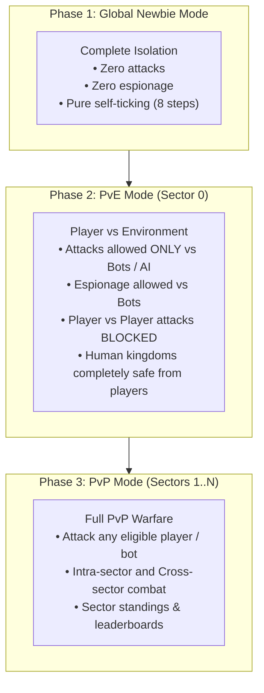

# Kingdom Interactions — Design & Rulebook

This document defines the core mechanics and rule sets governing how kingdoms interact with each other in **Super Kingdoms**.
It establishes the framework for espionage, military combat, target selection, economic raiding, inter-kingdom aid, and sector-level diplomacy across all game phases.

---

## 1. Overview & Phase Gating

All interactions are gated by the active **Game Phase** (see [PVE_REWORK_PLAN.md](file:///home/rija/Projects/pocketbase/super-kingdoms-pb/docs/PVE_REWORK_PLAN.md)):

| Interaction Type | Phase 1 (Newbie) | Phase 2 (PvE) | Phase 3 (PvP) |
|---|---|---|---|
| **Probe Reconnaissance (SoK / SoB / SoE)** | ❌ Blocked | ✅ Allowed vs Bots | ✅ Full (Players & Bots) |
| **Covert Sabotage / Ops** | ❌ Blocked | ⚠️ (Design choice) | ✅ Full |
| **Attacks: Standard Land Invasion** | ❌ Blocked | ✅ Allowed vs Bots | ✅ Full PvP |
| **Human vs Human Combat** | ❌ Blocked | ❌ **Strictly Blocked** | ✅ **Active** |
| **Aid / Resource Transfers** | ❌ Blocked | ❌ Blocked | ✅ Allowed (Sector members) |

---

## 2. Target Eligibility & Range Rules

To ensure competitive fairness and prevent griefing or exploitation, attacks and espionage must satisfy target eligibility criteria:

### 2.1 Networth (NW) Attack Range (3x Window)
Attacks are permitted only between kingdoms that are reasonably matched in economic and military scale:
- **State Requirement**: Both the attacker and the target must be in the **`active`** state (`attacker.state === "active"` and `target.state === "active"`).
- **3x Networth Rule**: An attack is allowed only if the difference in Networth between the attacker and the target is **less than 3x**:
  $$\frac{1}{3} < \frac{NW_{\text{target}}}{NW_{\text{attacker}}} < 3$$
  - **Minimum Target NW**: $NW_{\text{target}} > \frac{NW_{\text{attacker}}}{3}$ (attacker cannot punch down on kingdoms 3x or more smaller).
  - **Maximum Target NW**: $NW_{\text{target}} < 3 \times NW_{\text{attacker}}$ (attacker cannot hit kingdoms 3x or more larger).
- **System Enforcement**: Targets outside this range are filtered out or blocked with the error: `"Target is outside your attack range (must be within 3x Networth difference)"`.

### 2.2 Protection & Defensive Surge Mechanics
- **Non-Active Kingdoms**: Fallen/dead kingdoms (`state === "dead"`) or inactive accounts cannot be attacked or probed.
- **Newbie Protection**: Kingdoms currently in Newbie Mode cannot be attacked or targeted by espionage.
- **Defensive Alert Surge (Anti-Dogpiling)**:
  - Whenever a kingdom is **attacked and broken** (i.e. attacker achieves $\text{OP} > \text{DP}$ and captures land), the defender's military gains an immediate **+8% Defensive Bonus**:
    $$\text{Defensive Surge Bonus} \leftarrow \text{Defensive Surge Bonus} + 8\%$$
  - **Decay**: This bonus naturally decays by **1% every game tick** until it reaches zero:
    $$\text{Bonus}_{t+1} = \max(0, \text{Bonus}_t - 1\%)$$
  - *Example*: A kingdom broken in an attack immediately gains +8% defense on subsequent attacks during that tick. Over the next 8 ticks, the bonus scales down: $8\% \rightarrow 7\% \rightarrow 6\% \rightarrow \dots \rightarrow 1\% \rightarrow 0\%$.
  - This allows a kingdom to absorb an initial breach while becoming progressively harder to chain-break or dogpile in rapid succession.

---

## 3. Espionage & Reconnaissance (Probes)

Espionage provides critical intel before launching military offensives.

### 3.1 Intel Operations
1. **Status of Kingdom (SoK)**:
   - Reveals target's ruler, networth, land, unassigned soldiers, total population, and general military force estimate.
2. **Status of Buildings (SoB)**:
   - Reveals exact building breakdown (residences, power plants, barracks, factories, tech centers), construction queues, and rubble.
3. **Status of Economy (SoE)**:
   - Reveals current credits, power reserves, income per tick, and research progress.

### 3.2 Probe Mechanics & Success Probability Formula
When an espionage mission (SoK, SoB, SoE) is launched, the system resolves its success probability:

$$P_{\text{success}} = \min\left(1.0, \; \max\left(0.20, \; \frac{\text{sent\_probes}}{\text{defender\_probes}}\right)\right)$$

- **Defender Has 0 Probes**: If the target possesses 0 probes ($\text{defender\_probes} = 0$), success probability is automatically **100%** ($1.0$).
- **Minimum Success Floor**: Regardless of how vastly outnumbered the sent probes are by the defender's probe network, the baseline minimum probability is always **20%** ($0.20$).
- **Parity & Superiority**: If $\text{sent\_probes} \ge \text{defender\_probes}$, the mission achieves **100%** guaranteed success.
- **Resolution Outcomes & Probe Losses**:
  - **Successful Mission ($P \le P_{\text{success}}$)**:
    - The espionage report (SoK, SoB, or SoE) is generated and stored in `spyReports` for the attacker.
    - **Probe Loss**: Causes **0.25 (25%) probe losses** ($\lceil \text{sent\_probes} \times 0.25 \rceil$) of the sent probes (reflecting reconnaissance attrition/interceptions).
  - **Failed Mission ($P > P_{\text{success}}$)**:
    - The mission fails and no intelligence report is gathered.
    - **Probe Loss**: Causes **1.0 (100%) probe losses** ($\text{sent\_probes} \times 1.0$) of the sent probes (entire recon force intercepted and destroyed).
    - The target kingdom receives an alert notifying them of the failed espionage attempt.

---

## 4. Military Combat System (Attacks)

Military attacks are the primary driver of territorial expansion and conflict.

### 4.1 Attack Type: Standard Invasion
*(Note: Plunder / Resource Raids and Bombardment / Raze are excluded for now)*

- **Action**: The attacker dispatches an expeditionary army to invade a target kingdom.
- **Victory Condition**: Attacker's Offensive Power ($\text{OP}$) exceeds Defender's Defensive Power ($\text{DP}$):
  $$\text{OP} > \text{DP}$$
- **Land Grab**: A successful invasion seizes exactly **10% of the target's total land**:
  $$\text{Captured Land} = \lfloor \text{Defender Land} \times 0.10 \rfloor$$
  - The captured acres are deducted from the defender and transferred to the attacker as free/unbuilt land.
  - If $\text{OP} \le \text{DP}$, the invasion is repelled, and 0 land is captured.

### 4.2 Combat Casualties: 8% Loss Scaling
Casualties are calculated based on the engaged force, anchoring losses to **8% of the sent amount** (committed offensive force):

- **Unsuccessful Attack ($\text{OP} \le \text{DP}$)**:
  - **Loss Benchmark**: Exactly **8% of the sent attacking power amount** ($\text{Damage Benchmark} = \text{OP} \times 0.08$).
  - **Attacker Power Losses**: Attacker loses 8% of their sent attacking power:
    $$\text{Attacker Loss (Effective OP)} = \text{OP} \times 0.08$$
  - **Defender Power Losses**: Defender loses an equivalent 8% of the sent attacking power:
    $$\text{Defender Loss (Effective DP)} = \text{OP} \times 0.08$$
  - **Unit Losses & Military Bonus Scaling**:
    - Let $M_{\text{att}}$ be the attacker's total offensive multiplier (from race, tech, etc.).
    - Let $M_{\text{def}}$ be the defender's total defensive multiplier (from race, tech, buildings, defensive surge).
    - Base Attacking Unit Points Lost:
      $$\Delta \text{Base}_{\text{att}} = \frac{\text{Attacker Loss (Effective OP)}}{M_{\text{att}}} = \frac{\text{OP} \times 0.08}{M_{\text{att}}} = \text{Base Sent Units} \times 0.08$$
    - Base Defending Unit Points Lost:
      $$\Delta \text{Base}_{\text{def}} = \frac{\text{Defender Loss (Effective DP)}}{M_{\text{def}}} = \frac{\text{OP} \times 0.08}{M_{\text{def}}}$$
    - **Identical Military Bonuses ($M_{\text{att}} = M_{\text{def}}$)**: Both parties lose approximately the exact same number of base unit points (~8 points).
    - **Example**: An attacker sends **100 points** against **200 points** defense:
      - Both parties lose approx **8 points** ($100 \times 0.08$) if their military bonuses are identical.
      - If defender has higher defensive bonuses ($M_{\text{def}} > M_{\text{att}}$), defender loses fewer physical unit points ($\frac{8}{M_{\text{def}}}$), reflecting their fortified defenses.
    - *Anti-Griefing Protection*: Anchoring losses to the sent force prevents suicidal poke attacks (e.g. sending 1 soldier against 10,000 defense) from inflicting massive casualties on defending garrisons.
- **Successful Attack ($\text{OP} > \text{DP}$)**:
  - When the attacker breaks through, casualties scale relative to the defensive line broken ($\text{DP} \times 0.08$), causing 8% casualties to both sides relative to the engaged defensive line.
- **Unit Distribution**: Losses on each side are distributed proportionally across the active unit types participating in combat.

### 4.3 Combat Resolution Formula
When an attack is launched, the engine resolves Offense vs. Defense:

$$\text{Offensive Power (OP)} = \sum_{u \in \text{Attacking Army}} (\text{count}_u \times \text{off}_u) \times M_{\text{race}} \times M_{\text{tech}} \times M_{\text{warp}}$$

$$\text{Defensive Power (DP)} = \left[ \sum_{u \in \text{Defending Army}} (\text{count}_u \times \text{def}_u) \right] \times M_{\text{race}} \times M_{\text{tech}} \times M_{\text{buildings}} \times (1 + M_{\text{surge}})$$

*Where $M_{\text{surge}}$ is the active Defensive Surge Bonus (starts at +8% upon being broken, decaying by 1% per tick).*

- **Outcome**:
  - **Invasion Success ($\text{OP} > \text{DP}$)**:
    - Attacker captures 10% of defender's land ($\lfloor \text{Defender Land} \times 0.10 \rfloor$).
    - Both sides lose 8% of defensive line points.
    - Defender triggers the **+8% Defensive Surge Bonus** to shield against subsequent attacks.
  - **Invasion Repelled ($\text{OP} \le \text{DP}$)**:
    - Attacker captures 0 land.
    - Both sides lose 8% of sent points ($\text{OP} \times 0.08$).
    - Defender's surge bonus is unaffected.

---

## 5. Sector-Level Interactions (PvP Phase)

In Phase 3, players are split into sectors of 5 players (balanced across NW Tiers 1..5).

### 5.1 Intra-Sector vs Cross-Sector Interactions
- **Intra-Sector Combat (Same Sector)**:
  - Instant attack travel time (or 0-tick delay).
  - No warp travel penalties.
  - Local sector rivalries.
- **Cross-Sector Combat (Target in another Sector)**:
  - Requires **Warp Distance** calculation:
    $$\text{Travel Ticks} = \text{Base Travel} + f(\text{Distance})$$
  - Warp research (`warp`, `r_core`) reduces travel time and offensive penalties over long distances.

### 5.2 Sector Dynamics & Standings
- **Sector Leaderboards**: Aggregated Networth of all 5 kingdoms in a sector.
- **Sector Defense / Coordination**:
  - Shared sector radar (visibility into incoming attacks targeting sector members).
  - Sector communication / war room.

---

## 6. Peaceful Interactions: Aid & Trade

- **Resource Aid**:
  - Players may send money or power to fellow sector members.
- **Anti-Exploit Controls**:
  - **Aid Cap**: Kingdoms can only send/receive a maximum of $Z\%$ of their networth per day.
  - **Transport Tax**: 10%–20% transport fee burned during resource delivery.
  - Aid is unlocked only in Phase 3 between confirmed sector members.

---

## 7. Open Design Decisions & Questions for Review

Please review and specify your preferences on the following key mechanics:

1. **Combat Casualty Ratios** *(RESOLVED)*:
   - Fixed at **8% of sent amount on both sides** (e.g. 100 offense sent against 200 defense yields ~8 points lost for both attacker and defender).
2. **Land Grab Percentage** *(RESOLVED)*:
   - Fixed at **10% of target's land** ($\lfloor \text{Defender Land} \times 0.10 \rfloor$) on successful invasion.
3. **Attack Cooldown & Daily Limit**:
   - Should attacks cost a resource (e.g. Attack Credits, Energy, or Ticks)?
   - Can a player attack the same target multiple times in a row, or is there a cooldown (e.g., max 3 attacks on the same target per 24h)?
4. **Cross-Sector Attacks in PvP**:
   - Should players in Phase 3 be able to attack players in *other* sectors, or is Phase 3 combat strictly restricted to players within their own assigned sector?
5. **Bot Behavior in PvE**:
   - Should bots in Phase 2 remain passive targets for training, or should aggressive bot profiles occasionally launch counter-raids against player kingdoms?
