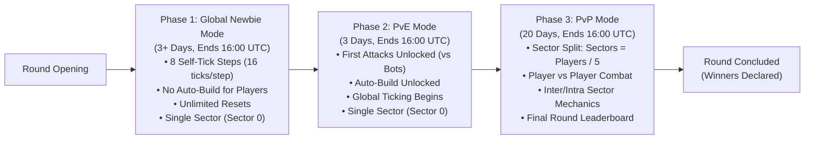
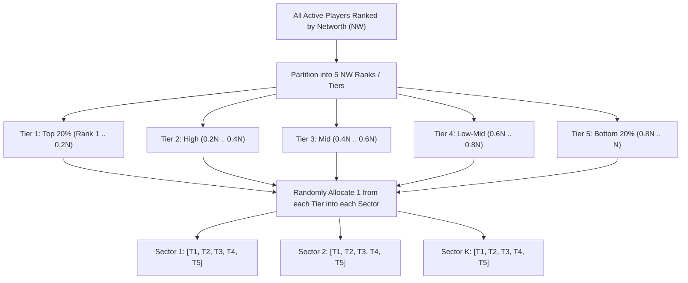

# PvE Mode & Round Lifecycle Rework — Feature Design & Planning Document

## 1. Overview & Objective

This document outlines the ground-up rework of the **PvE Mode** and the broader **Round Lifecycle** for Super Kingdoms.
Formal requirements tracking for this feature is defined in [pve-mode-rework.requirements.md](file:///home/rija/Projects/pocketbase/super-kingdoms-pb/docs/requirements/pve-mode-rework.requirements.md).
The game round will progress through three distinct, timed phases, each with specific game rules, mechanics, and sector arrangements:

---

## 2. Phase Breakdown & Timeline

Every phase transition strictly occurs at **16:00:00 UTC**.

| Phase | Name | Base Duration | Transition Time | Sector Structure | Combat State | Auto-Build (Real Players) |
|---|---|---|---|---|---|---|
| **Phase 1** | **Global Newbie Mode** | 3+ Days (Configurable) | Starts: Round Start Ends: 16:00:00 UTC | Single Sector (`sector: 0`) | Disabled | **Disabled** (Manual only) |
| **Phase 2** | **PvE Mode** | Exactly 3 Days (72h) | Starts: 16:00:00 UTC Ends: 16:00:00 UTC | Single Sector (`sector: 0`) | **Unlocked vs Environment / Bots** | **Unlocked** |
| **Phase 3** | **PvP Mode** | Exactly 20 Days (480h) | Starts: 16:00:00 UTC Ends: 16:00:00 UTC | **Partitioned Sectors** (Count = `ceil(Players / 5)`) | **Full PvP Unlocked** | **Unlocked** |

---

## 3. Phase 1: Global Newbie Mode Mechanics

### 3.1 Step-Based Self-Ticking
- **Abstraction**: Instead of raw ticks, players are presented with **8 Progression Steps** (e.g., Step 1/8 to Step 8/8).
- **Internal Execution**: Each step triggers **16 engine simulation ticks** in one batch:
  $$\text{Total Simulated Ticks} = 8 \text{ steps} \times 16 \text{ ticks/step} = 128 \text{ ticks}$$
- **UI Presentation**:
  - The UI displays a clear step indicator (e.g. `Step 3 of 8` or `5 steps remaining`).
  - The player does not see confusing raw tick counters or "+16 ticks" notifications; the interface focuses on the kingdom's strategic growth from step to step.
- **Global Clock**: Global background round ticking is inactive or does not advance player realms during Newbie Mode. Players advance strictly when they choose to click "Next Step".

### 3.2 Auto-Build Restriction
- **Real Players**: `autoBuild` is strictly disabled during Global Newbie Mode.
  - Toggling auto-build on is blocked in the UI and rejected by the API.
  - Players must manually allocate resources, construct buildings, research technologies, and recruit units before advancing to the next step.
- **Bots / AI**: Pre-generated bot kingdoms utilize their bot profiles to simulate their development up to 128 ticks.

### 3.3 Unlimited Reset Capability & Trait Re-Selection
- A player may reset their kingdom at any point during Phase 1:
  - Resets all buildings, military, land, research, and resources to creation-default values.
  - Restores the step counter back to 8 steps remaining.
  - Resets are unlimited during Phase 1, encouraging players to experiment with different builds and strategies until satisfied.
- **Reset Confirmation & Customization Dialog**:
  - Clicking "Reset Newbie Build" opens a styled modal dialog instead of an abrupt action.
  - **Trait Modification**: Within the dialog, the player can optionally select a new **Planet Type** and **Race** from dropdowns or visual cards (pre-selected to their current traits).
  - This enables players to test different racial bonuses and planetary perks without having to delete and re-register their kingdom account.
- **Backend API**:
  - `POST /api/kingdoms/restart-newbie-mode` accepts optional `{ planetType?: string, raceType?: string }`.
  - Validates selections against allowed game types.
  - Saves the new traits, resets all progression to initial defaults, and sets steps to 8.
- Once Phase 1 ends and Phase 2 begins, the reset option is locked.

### 3.4 Synchronized Military Production Duration (16 Ticks)
- In standard gameplay, specialized military unit recruitment queues typically take 24 ticks (with soldiers at 16 ticks).
- **Phase 1 Rule**: During Global Newbie Mode, military production duration for **all unit types** is set to **16 ticks**.
- **Impact**: Because each self-tick step executes exactly 16 ticks under the hood, any military recruits ordered in a step complete their training queue within that single step! Players can immediately see and use their units in the next step.

### 3.5 Step 8 Prerequisite: 8,000 Base Military Defensive Points (Active + Queued)
- To ensure players do not enter PvE and PvP completely defenseless, the system enforces a defense readiness gate before the final newbie step.
- **Rule**: A player **cannot advance the final step (Step 8)** of Global Newbie Mode unless their kingdom commands at least **8,000 base military defensive points** before bonuses, combining **already produced military units** and **units currently in recruitment queues**.
- **Base Defense Formula (Before Bonuses)**:
  $$\text{Base Defensive Points} = \sum_{\text{unit } u} \left[ (\text{activeCount}_u + \text{queuedCount}_u) \times \text{def}_u \right] \ge 8{,}000$$
  *Where $\text{def}_u$ is the unit's intrinsic base defense value (ignoring racial, tech, or building multipliers):*
  - **Soldier (`sol`)**: 1 def
  - **Laser Trooper (`lt`)**: 4 def
  - **Laser Dragoon (`ld`)**: 5 def
  - **Laser Fighter (`lf`)**: 6 def
  - **F-74 (`f74`)**: 8 def
  - **Tank (`t`)**: 9 def
  - **Heavy Tank (`ht`)**: 12 def
  - *(Offensive units: `tr`, `dr`, `ft`, `tf`, and `sci` have 0 def)*
- **UI & Error Handling**:
  - The Step Progression panel displays the readiness progress: `"Defensive Readiness: X,XXX / 8,000 Base Def (Active + Queued)"`.
  - The Step 8 advance button is disabled until the 8,000 base defense threshold is reached.
  - If the player attempts to self-tick step 8 with insufficient defense, the API rejects the action with a clear error: `"Defensive readiness requirement not met: you need at least 8,000 base military defensive points (active + training queue) before advancing the final step (current: X,XXX)"`.

### 3.6 Free Land Optimization Warning (> 16 Free Land)
- **Goal**: Prevent players from accidentally advancing steps without developing newly explored or idle land, ensuring they maintain proper economic and housing growth.
- **Rule**: In Phase 1, if a player has **more than 16 free (unbuilt) land** available when clicking to advance to the next step, the game interrupts the action and presents a confirmation dialog.
- **Calculation**:
  $$\text{Free Land} = \text{total land} - \left( \sum \text{completed buildings} + \sum \text{buildings in construction queue} + \text{rubble} \right)$$
- **Prompt Dialog UX & Aesthetics**:
  - **No browser default alerts** (per `/no-alerts` guideline). A sleek, modern custom modal with glassmorphism backdrop (`backdrop-filter: blur(8px)`), rounded corners, and subtle amber warning accent.
  - **Content**:
    - **Header**: `⚠️ Unbuilt Land Available`
    - **Body**: *"You currently have **{freeLand} acres of undeveloped land**. Advancing to the next step without constructing buildings means missing out on vital income, energy, or population capacity."*
    - **Quick Stat Badge**: Displays free land vs total land with icon.
    - **Actions**:
      - `[Construct Buildings]` (Primary / Recommended): Closes modal and navigates directly to `/kingdom/buildings`.
      - `[Advance Step Anyway]` (Secondary / Subtle outline): Dismisses the warning and executes the self-tick step.

---

## 4. Phase 2: PvE Mode (Player vs Environment)

### 4.1 Timing & Sector Arrangement
- Begins automatically at 16:00:00 UTC on the scheduled completion of Global Newbie Mode.
- Lasts for **3 days (72 hours)**.
- **Sector**: All players and bots remain in the shared initial sector (`sector: 0`).

### 4.2 Automated Bot Spawning & 128-Tick Fast-Forward
At the exact moment Phase 1 ends (16:00:00 UTC), the server runs an automated bot generation routine before opening Phase 2 PvE targets:

1. **Bot Spawn Count Formula**:
   $$\text{Bot Count} = \max(21, 5 \times \text{Active Player Kingdoms})$$
   *(e.g., 10 human players $\rightarrow \max(21, 50) = 50$ bots; 3 human players $\rightarrow \max(21, 15) = 21$ bots).*
2. **Bot Initialization Attributes**:
   - **Cash Endowment**: Spawned with **300K extra starting cash** (totaling **600,000 money**, compared to 300,000 for standard creations).
   - **Bot Profile**: Randomly assigned build profile (Aggressive, Turtle, Industrialist, Scientist, Balanced) with tailored building ratios and research priorities.
   - **Auto-Build**: Set to `autoBuild: true`.
   - **Sector**: Initialized in `sector: 0`.
3. **Automated 8-Step (128 Ticks) Simulation**:
   - Each bot kingdom is immediately simulated through the full **8 steps (16 ticks per step = 128 ticks total)** using the Go tick engine.
   - The bots invest their 600K cash into exploring land, constructing specialized buildings, advancing tech trees, and recruiting defensive and offensive military forces.
   - **Result**: When human players enter Phase 2 PvE, they face mature, organically structured, diverse AI kingdoms ready for combat.

### 4.3 First Attacks & Target Rules
- Combat is officially unlocked! *(See [KINGDOM_INTERACTIONS.md](file:///home/rija/Projects/pocketbase/super-kingdoms-pb/docs/KINGDOM_INTERACTIONS.md) for detailed combat formulas and rules)*
- **Attack Mechanics**:
  - **Attack Type**: **Standard Invasion** (Plunder and Bombardment are removed/deferred).
  - **Land Grab**: Successful attacks seize **10% of target's land** ($\lfloor \text{Defender Land} \times 0.10 \rfloor$).
  - **Casualties**: Unit kill ratio is fixed at **8% on both sides** (attacker and defender both lose 8% of committed/defending units).
  - **Defensive Alert Surge**: When a kingdom is attacked and broken, its defensive bonus increases by **+8%**, decaying by **1% every tick** until reaching 0%.
- **Target Restriction & Range**:
  - **3x Networth Window**: Both kingdoms must be `active`, and their Networth difference must be strictly less than 3x ($NW_{\text{attacker}} / 3 < NW_{\text{target}} < 3 \times NW_{\text{attacker}}$).
  - Real players may attack **Environment targets** (the spawned bot kingdoms).
  - Real players **cannot** attack or be attacked by other real human players during PvE.
  - This allows players to test their military compositions, practice combat formulas, and expand their land base in a safe environment.
- **Auto-Build**: Unlocked for real players to automate ongoing growth if desired.
- **Server Tick**: The game round advances via automated periodic server ticks (e.g., once per hour or at a configured game tick rate).

---

## 5. Phase 3: PvP Mode & Sector Splitting

### 5.1 Sector Splitting Algorithm & Networth (NW) Tier Partitioning

At exactly 16:00:00 UTC when Phase 2 ends, the system automatically runs the **NW-Tier Balanced Sector Splitting Procedure**:

#### Step 1: Calculate Total Sectors
$$\text{Total Sectors } S = \max\left(1, \left\lceil \frac{\text{Active Player Count } N}{5} \right\rceil\right)$$
- *Example*: 25 active players $\rightarrow 25 / 5 = 5$ sectors.
- *Example*: 23 active players $\rightarrow \lceil 23 / 5 \rceil = 5$ sectors.

#### Step 2: Rank & Partition into 5 NW Tiers
1. Sort all active players by `nw` descending: $P = [p_1, p_2, \dots, p_N]$.
2. Divide into 5 equal (or near-equal) slices:
   - **Tier 1 (Top 20%)**: Ranks 1 to $\lfloor 0.2 \times N \rfloor$
   - **Tier 2 (High-Mid 20%)**: Next slice of players
   - **Tier 3 (Mid 20%)**: Next slice of players
   - **Tier 4 (Low-Mid 20%)**: Next slice of players
   - **Tier 5 (Bottom 20%)**: Remaining slice of players

#### Step 3: Balanced Sector Allocation
1. For each Tier $t \in [1..5]$:
   - Shuffle the players within Tier $t$ randomly.
   - Distribute each player from Tier $t$ one-by-one across sectors $1 \dots S$.
2. **Outcome**:
   - Every sector receives an evenly matched composition (ideally 1 player from Tier 1, 1 from Tier 2, 1 from Tier 3, 1 from Tier 4, and 1 from Tier 5).
   - This prevents "stacked" sectors where top players dominate a single sector or weaker players are left defenseless, ensuring high-stakes, balanced competition across all sectors.

#### Step 4: Bot Placement
- Environment bots are either distributed proportionally across all sectors or assigned to a designated frontier zone.

### 5.2 PvP Combat & Mechanics
- **Intra-Sector Combat & Probing**: Full warfare and espionage are unlocked between all kingdoms residing in the same sector within the 3x Networth window.
- **Inter-Sector Restrictions & 48h Inactivity Rule**:
  - Inter-sector attacks and inter-sector probe missions are **blocked** between active kingdoms.
  - If a kingdom in another sector becomes **inactive (48 hours idle)**, inter-sector attacks and probe missions are unlocked against it from any sector (within 3x NW).
- **Sector Dynamics**:
  - Sector rankings & leaderboards (networth, military strength).
  - Sector coordination and shared radar.
- **Duration**: Phase 3 runs for **20 days**, concluding at 16:00:00 UTC.
- **End of Round**:
  - The round officially ends (`status: "ended"`).
  - Final standings are recorded in the round history archive.

---

## 6. Architecture & Implementation Plan

### 6.1 Database & Schema Additions
1. **`gameStatus` Collection**:
   - `phase`: String enum (`"newbie" | "pve" | "pvp" | "ended"`).
   - `phaseEndTime`: ISO timestamp / UTC timestamp for the next transition (always at 16:00:00 UTC).
   - `newbieDurationDays`: Number (default: 3).
   - `pveDurationDays`: Number (default: 3).
   - `pvpDurationDays`: Number (default: 20).
   - `sectorCount`: Number of active sectors.
2. **`kingdoms` Collection**:
   - `newbieStepsRemaining`: Integer (starts at 8, decrements by 1 per self-tick step).
   - `sector`: Integer (0 during Newbie and PvE, 1..N during PvP).
   - `autoBuild`: Boolean (enforced `false` during Newbie phase).

### 6.2 Backend Endpoints & Engine
1. **Self-Tick Step Handler (`POST /api/kingdoms/self-tick`)**:
   - Validates active phase is `"newbie"`.
   - Checks `newbieStepsRemaining >= 1`.
   - Runs `engine.ProcessKingdomTick(kd, tick)` **16 times** in a single database transaction.
   - Decrements `newbieStepsRemaining` by 1.
   - Returns updated kingdom state and remaining steps.
2. **Reset Step Handler (`POST /api/kingdoms/restart-newbie-mode`)**:
   - Allowed at any point during `"newbie"` phase.
   - Accepts optional `{ planetType?: string, raceType?: string }` payload.
   - Resets kingdom to creation defaults, applies new planet/race if provided, and resets `newbieStepsRemaining = 8`.
3. **Automated Phase Scheduler (`cmd/server/scheduler.go` or PocketBase Hook)**:
   - Evaluates current UTC time against `gameStatus.phaseEndTime`.
   - When 16:00:00 UTC is reached:
     - **Newbie $\rightarrow$ PvE**: Update phase to `"pve"`, set next `phaseEndTime` to `now + 3 days at 16:00:00 UTC`.
     - **PvE $\rightarrow$ PvP**: Execute sector splitting algorithm, update `sector` on all player records, update phase to `"pvp"`, set next `phaseEndTime` to `now + 20 days at 16:00:00 UTC`.
     - **PvP $\rightarrow$ Ended**: Finalize round scores and set status to `"ended"`.

### 6.3 Frontend UI / UX
1. **Header / Phase Banner**:
   - Displays current phase badge: `🌱 Global Newbie Mode`, `🛡️ PvE Mode`, or `⚔️ PvP Sector Warfare`.
   - Countdown timer to next phase: `Phase transition: X days Y hours (16:00 UTC)`.
2. **Newbie Step Progression Panel**:
   - Stepper widget showing 8 steps with visual milestones.
   - Action button: `"Advance to Step X"` (disabled when 0 steps remaining).
   - Prominent `"Reset Newbie Build"` button opening the reset customization modal.
   - Warning banner if attempting to toggle Auto-Build: `"Auto-build is disabled during Newbie Mode"`.
3. **Reset Newbie Modal (`ResetNewbieModal`)**:
   - High-fidelity confirmation modal explaining that stats will be returned to initial defaults.
   - Interactive selectors allowing player to change **Planet Type** and **Race Type** before confirming.
4. **Unbuilt Land Warning Modal (`UnbuiltLandModal`)**:
   - Modern glassmorphism dialog triggered if free land > 16 when clicking advance.
   - Shows badge with unbuilt acreage and direct shortcuts to construct buildings or proceed anyway.
5. **PvE & PvP Combat Views**:
   - PvE: Target finder filtered exclusively to environment/bot targets.
   - PvP: Sector overview showing fellow sector members, rankings, and attack options.

---

## 7. Open Questions & Points for Review

Please review and share your thoughts on the following design choices:

1. **Bot Generation & Progression** *(RESOLVED)*:
   - At the end of Phase 1 (16:00:00 UTC), server spawns $5\times \text{active kingdoms}$ (minimum 21 bots), each with +300K extra cash ($600K total), and runs the 8 steps (128 ticks) automatically with assigned bot profiles before Phase 2 starts.
2. **PvE Attack Types & Stakes** *(RESOLVED)*:
   - Attack type is Standard Invasion only (Plunder and Bombardment removed/deferred). Land grab is 10% of target's land. Unit casualties are 8% on both sides.
   - *Sub-question*: Can bots retaliate against players during PvE, or are bots passive training targets?
3. **Sector Splitting & Bot Placement**:
   - In PvP (when players are partitioned into sectors of 5), how should bots be placed?
     - Option A: Bots are also split across all sectors (e.g. 5 players + 5 bots per sector).
     - Option B: Sectors contain only human players, and bots remain in an open "Wilderness/Neutral" sector.
4. **Round Duration & Ticking Speed**:
   - During PvE (3 days) and PvP (20 days), what should the global tick frequency be? (e.g., 1 tick every 60 minutes = 24 ticks/day, or 1 tick every 30 minutes = 48 ticks/day).
5. **Newbie Extension Policy**:
   - If an admin extends Global Newbie Mode, does every player get more steps, or does it simply give late-joining players more calendar time to complete their 8 steps before PvE opens?
