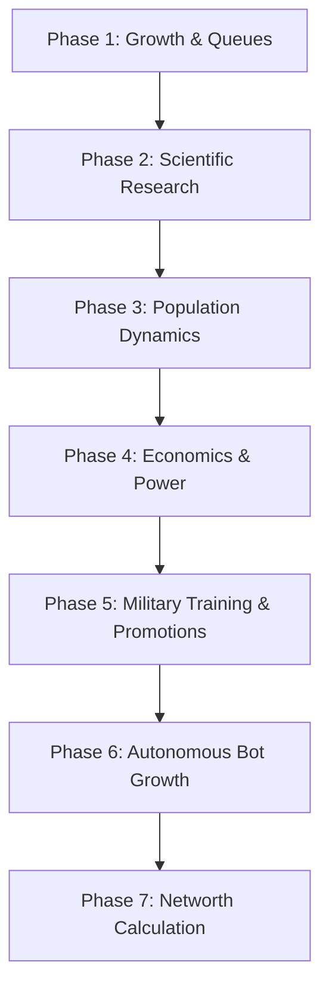

# Super Kingdoms — Tick Simulation Engine Specification

This document details the mechanics, math, concurrency model, and database persistence strategy of the game simulation engine.

---

## 1. Engine Overview

A **Tick** represents 1 hour of in-game time in Super Kingdoms. A standard game round consists of **960 ticks** (~40 real-world days at 1 tick/hour).

When a tick triggers (either via cron timer or manual trigger):
1. The **game phase** is checked: the tick aborts unless `gameStatus.status` is `in-progress` (so `registration` and `stopped` both refuse ticks); then if `currentTick >= endTick`, the tick aborts and the phase is set to `stopped`.
2. `currentTick` is incremented by 1 in `gameStatus`.
3. All active (non-`dead`) kingdoms are queried from SQLite.
4. Kingdoms are partitioned across **all available CPU cores** using a parallel worker pool.
5. Each kingdom undergoes a **7-phase deterministic simulation**.
6. The updated kingdom states are committed in a single **high-speed batched SQLite transaction**.

---

## 2. Concurrency Architecture

### Single-Threaded JSVM vs Multi-Core Go

```
┌────────────────────────────────────────────────────────┐
│               Client / Admin / Cron Trigger            │
└───────────────────────────┬────────────────────────────┘
                            │ POST /api/game/advance-tick
                            ▼
┌────────────────────────────────────────────────────────┐
│           PocketBase Go Native Dispatcher              │
│       - Loads N kingdom records from SQLite            │
│       - Partitions records into NumCPU slices          │
└───────────────┬────────────────────────────┬───────────┘
                │                            │
   ┌────────────┴────────────┐  ┌────────────┴────────────┐
   │ Goroutine 1 (Core 1)    │  │ Goroutine N (Core N)    │
   │ Kingdoms [0 : N/cores]  │  │ Kingdoms [...]          │
   │ Phases 1–7 simulation   │  │ Phases 1–7 simulation   │
   └────────────┬────────────┘  └────────────┬────────────┘
                │                            │
                └─────────────┬──────────────┘
                              ▼
                ┌────────────────────────────┐
                │       sync.WaitGroup       │
                │   (All partitions complete)│
                └─────────────┬──────────────┘
                              ▼
                ┌────────────────────────────┐
                │   Single-Writer SQLite     │
                │     Batch Transaction      │
                │  - Prepared UPDATE stmt    │
                │  - WAL journal mode        │
                │  - Zero lock contention    │
                └────────────────────────────┘
```

### Why Parallel Simulation + Single Batch Write?
- **CPU Simulation (Embarrassingly Parallel):** Each kingdom's state on tick $T$ depends solely on its own state at $T-1$ and the current tick number. No kingdom reads another kingdom's state during the tick. This allows $100\%$ lock-free parallel execution across all CPU cores.
- **SQLite Persistence (Single Writer):** SQLite allows concurrent readers in WAL mode, but only **one write transaction at any instant**. Attempting to write from multiple threads causes `SQLITE_BUSY: database is locked`. By aggregating all in-memory simulation results and committing them in a **single sequential prepared batch transaction**, we achieve maximum I/O throughput with zero lock contention.

---

## 3. Seven-Phase Simulation Lifecycle

For each kingdom, the engine executes the following phases in strict order:



---

### Phase 1: Growth & Construction Queues

Queues represent pipeline delays for exploration and building construction.

1. **Land Exploration Arrival:**
   - If `landQueue` has entries:
     $$\text{land} \leftarrow \text{land} + \text{landQueue}[0]$$
     $$\text{landQueue} \leftarrow \text{landQueue}[1:]$$
2. **Building Construction Completion:**
   - For each building key $k \in \{\text{res, plants, rax, sm, pf, tc, asb}\}$:
     - If `buildings.queue[k]` has entries:
       $$\text{buildings}[k] \leftarrow \text{buildings}[k] + \text{queue}[k][0]$$
       $$\text{queue}[k] \leftarrow \text{queue}[k][1:]$$

---

### Phase 2: Scientific Research & Tech Tree

1. **Scientist Output:**
   - Every scientist (`military.sci`) produces 1 research point per tick:
     $$\text{researchPts} \leftarrow \text{researchPts} + \text{military.sci}$$
2. **Auto-Assignment Pipeline:**
   - If `researchAutoAssign` is configured and $\text{researchPts} > 0$, points are allocated to topics in priority order until needed points for that topic are met.
3. **Topic Cost Calculation:**
   - Standard topics ($\text{pop, power, mil, money, fdc, warp}$):
     $$\text{Required} = \text{round}(\text{land}^2 \times \text{weight})$$
     $$\text{Bonus \%} = \min\left(\left\lfloor \frac{\text{bonus}_{\max} \times \text{pts}}{\text{Required}} \right\rfloor, \text{bonus}_{\max}\right)$$
   - Tech Tree breakthroughs ($\text{r\_dr, r\_ft, r\_tf, r\_f74, r\_ld, r\_lf, r\_fusion, r\_core, r\_armor, r\_long, r\_ht}$):
     - Require specific point thresholds (e.g. 30,000 to 300,000 pts) and prerequisite techs.
     - Progress is percentage towards $100\%$.

---

### Phase 3: Population Dynamics & Housing

1. **Housing Capacity:**
   - Base residential capacity: $50$ pop/res (+5 with `r_long` tech).
   - Military barracks capacity: $75$ slots/rax.
   - Heavy tanks (`t`, `ht`) consume 2 barracks slots; other units consume 1 slot.
   - Barracks overflow spills into residences:
     $$\text{raxSurplus} = \max(0, \text{militaryCount} - \text{rax} \times 75)$$
     $$\text{resCap} = (50 + \text{longBonus}) \times (1 + \text{popBonus})$$
     $$\text{maxPop} = \max(0, \lfloor\text{buildings.res} \times \text{resCap} - \text{raxSurplus}\rfloor)$$
2. **Population Growth / Decline:**
   - If $\text{pop} < \text{maxPop}$:
     $$\Delta\text{pop} = \min(\lceil \text{pop} \times 0.05 \rceil, \text{maxPop} - \text{pop})$$
   - If $\text{pop} > \text{maxPop}$:
     $$\Delta\text{pop} = -\text{round}\left(\max\left(100, \frac{\text{land}}{10}, \text{pop} \times 0.05\right)\right)$$
   - If $\text{pop} + \Delta\text{pop} \le 0$, kingdom state transitions to **`dead`**.

---

### Phase 4: Economics & Energy Balance

1. **Money Income:**
   - SM (Solar Mills) produce 140 credits/tick. Citizens produce 2 credits/tick.
     $$\text{moneyIncome} = \text{round}((\text{sm} \times 140 + \text{pop} \times 2) \times (1 + \text{moneyBonus}))$$
     $$\text{money} \leftarrow \text{money} + \text{moneyIncome}$$
2. **Power Generation & Consumption:**
   - Power plants produce 100 MW each, boosted by Power Research, Fusion (`r_fusion` +50%), and Core (`r_core` +20%).
   - Consumption: Population consumes 0.032 MW/person. Military units consume 0.7–1.4 MW each.
   - Net balance:
     $$\text{powerIncome} = \text{Generation} - \text{Consumption}$$
     $$\text{power} = \min(\text{plants} \times 1000, \max(0, \text{power} + \text{powerIncome}))$$
3. **Probes:**
   - Probe factories (`pf`) produce 1 probe per tick.

---

### Phase 5: Military Training & Promotions

1. **Queue Delivery:**
   - Completed units from `military.queue` for all 12 unit types enter active service.
2. **Automated Technological Promotions:**
   - When advanced tech research reaches $100\%$, lower-tier units automatically promote up into higher-tier combatants:
     - `r_ld` (100%): 5 Light Troops (`lt`) $\rightarrow$ 4 Laser Drones (`ld`) + remainder as Soldiers.
     - `r_lf` (100%): 6 Laser Drones (`ld`) $\rightarrow$ 5 Laser Fighters (`lf`) + remainder.
     - `r_dr` (100%): 5 Troopers (`tr`) $\rightarrow$ 4 Drones (`dr`) + remainder.
     - `r_ft` (100%): 6 Drones (`dr`) $\rightarrow$ 5 Fighters (`ft`) + remainder.
     - `r_ht` (100%): 12 Tanks (`t`) $\rightarrow$ 9 Heavy Tanks (`ht`) + remainder.

---

### Phase 6: Autonomous Bot Growth (Every 12 Ticks or Tick 1)

For all AI-controlled kingdoms with `autoBuild: true`:

1. **Auto Exploration:**
   - Calculates affordable land parcels up to `autoExplore %` limit using square-root land cost scaling:
     $$\text{Cost/Land} = \text{round}(\sqrt{\text{land}} \times 111 \times \text{levelMult} \times \text{landMult})$$
   - Distributes land in 24-tick pipeline queue.
2. **Auto Building:**
   - Identifies deficit against target building distribution ratios (`res`, `plants`, `rax`, `sm`, `pf`, `tc`, `asb`).
   - Purchases batches of 16 buildings on free land at $\text{Cost} = \text{round}(\sqrt{\text{land}} \times 63)$.
   - Distributes construction across 16-tick pipeline queue.
3. **Auto Military:**
   - Recruits unassigned Soldiers up to 10% population training capacity.
   - Equips advanced units according to target military ratios, respecting aerospace base (`asb`) housing and tech prerequisites.

---

### Phase 7: Networth Calculation

Networth measures the total economic, military, and territorial power of the realm:

$$\text{NW} = \text{NW}_{\text{military}} + \text{NW}_{\text{land}} + \text{NW}_{\text{buildings}} + \text{NW}_{\text{pop}} + \text{NW}_{\text{money}} + \text{NW}_{\text{probes}}$$

| Category | Value per Unit |
|---|---|
| Land | 25 NW / acre |
| Buildings | 25 NW / building |
| Population | 1 NW / citizen |
| Money | 1 NW per 500 credits |
| Probes | 1 NW per 1,000 probes |
| Soldiers (`sol`) | 3 NW |
| Troopers / Light Troops (`tr`, `lt`) | 6 NW |
| Drones / Laser Drones (`dr`, `ld`) | 8 NW |
| Fighters / Laser Fighters (`ft`, `lf`) | 10 NW |
| F-74 Interceptor (`f74`) | 12 NW |
| Tactical Fighters (`tf`) | 18 NW |
| Tanks (`t`) | 22 NW |
| Heavy Tanks (`ht`) | 31 NW |
| Scientists (`sci`) | 8 NW |

---

## 4. Performance Scaling Profile

With the native Go multi-threaded engine:

| Kingdom Count | Go Worker Threads | CPU Sim Time | SQLite Batch Write | Total Tick Time |
|---|---|---|---|---|
| **1,000** | All cores | **~ 1 ms** | **~ 25 ms** | **~ 26 ms** |
| **10,000** | All cores | **~ 8 ms** | **~ 220 ms** | **~ 228 ms** |
| **50,000** | All cores | **~ 35 ms** | **~ 950 ms** | **~ 985 ms** |
| **100,000** | All cores | **~ 70 ms** | **~ 1.8 s** | **~ 1.9 s** |
